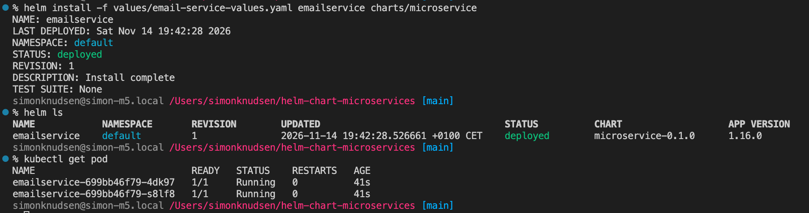
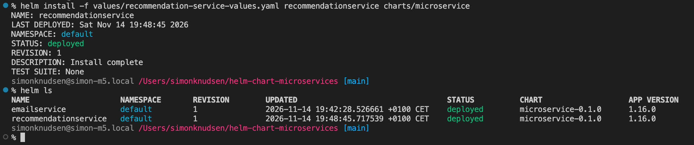
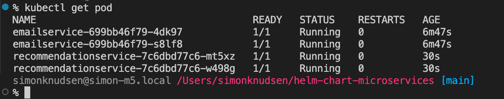

# Create Helm Chart for Microservices

**Technologies used:** Kubernetes, Helm

## Project Description

Create 1 shared Helm Chart for all microservices, to reuse common Deployment and Service configurations for the services.

One generic chart (`charts/microservice`) deploys every microservice, with a separate values file per service in `values/`. All releases can be installed at once with `install.sh` or `helmfile.yaml`.

## Screenshots

*Installing `emailservice` from the shared chart, with its 2 pods running.*

 

*Installing `recommendationservice` from the same chart with a different values file.*

 

*Pods for both services running, deployed from one shared chart.*
