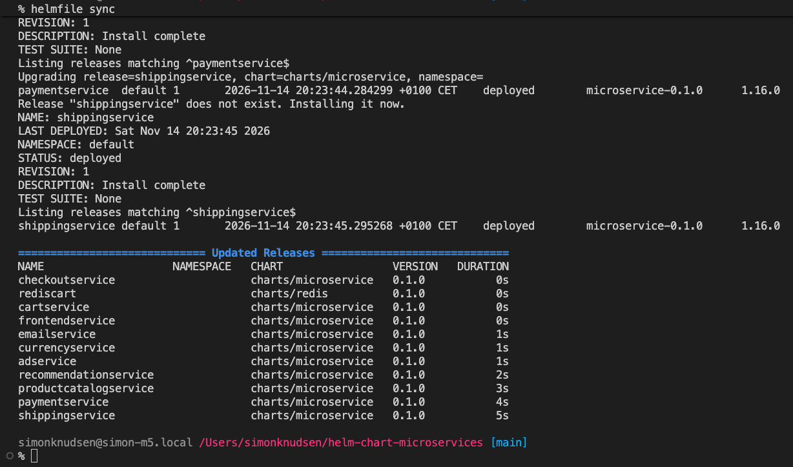
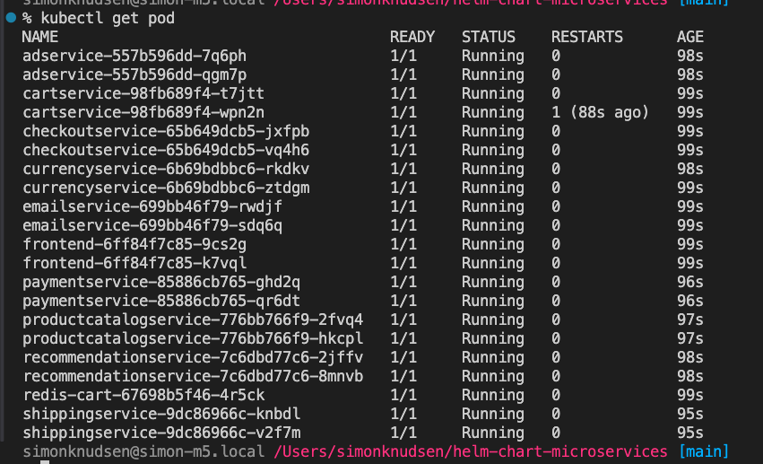
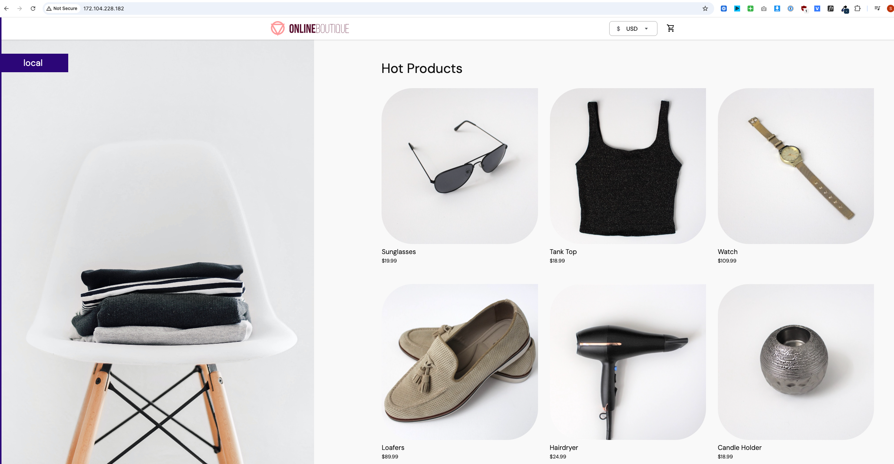

# Create Helm Chart for Microservices

**Technologies used:** Kubernetes, Helm

## Project Description

Create 1 shared Helm Chart for all microservices, to reuse common Deployment and Service configurations for the services.

One generic chart (`charts/microservice`) deploys every microservice, with a separate values file per service in `values/`. All releases can be installed at once with `install.sh` or `helmfile.yaml`.

## Screenshots

*Installing `emailservice` from the shared chart, with its 2 pods running.*

 

*Installing `recommendationservice` from the same chart with a different values file.*

 

*Pods for both services running, deployed from one shared chart.*

 

# Deploy Microservices with Helmfile

**Technologies used:** Kubernetes, Helm, Helmfile

## Project Description

- Deploy Microservices with Helm
- Deploy Microservices with Helmfile

`helmfile.yaml` declares every release in one file: the Redis cart database (`charts/redis`) and 10 microservices that all use the shared `charts/microservice` chart, each with its own values file. A single `helmfile sync` installs or upgrades all of them in one step, instead of running `helm install` once per service.

## Screenshots

*Running `helmfile sync`: all 11 releases (Redis plus 10 microservices) are installed from `helmfile.yaml` in one command.*

 

*`kubectl get pod` after the sync: every microservice runs 2 replicas, plus one `redis-cart` pod, all in `Running` status.*

 

*The final result: the Online Boutique shop, served by the frontend service and reachable in the browser through its external IP.*
